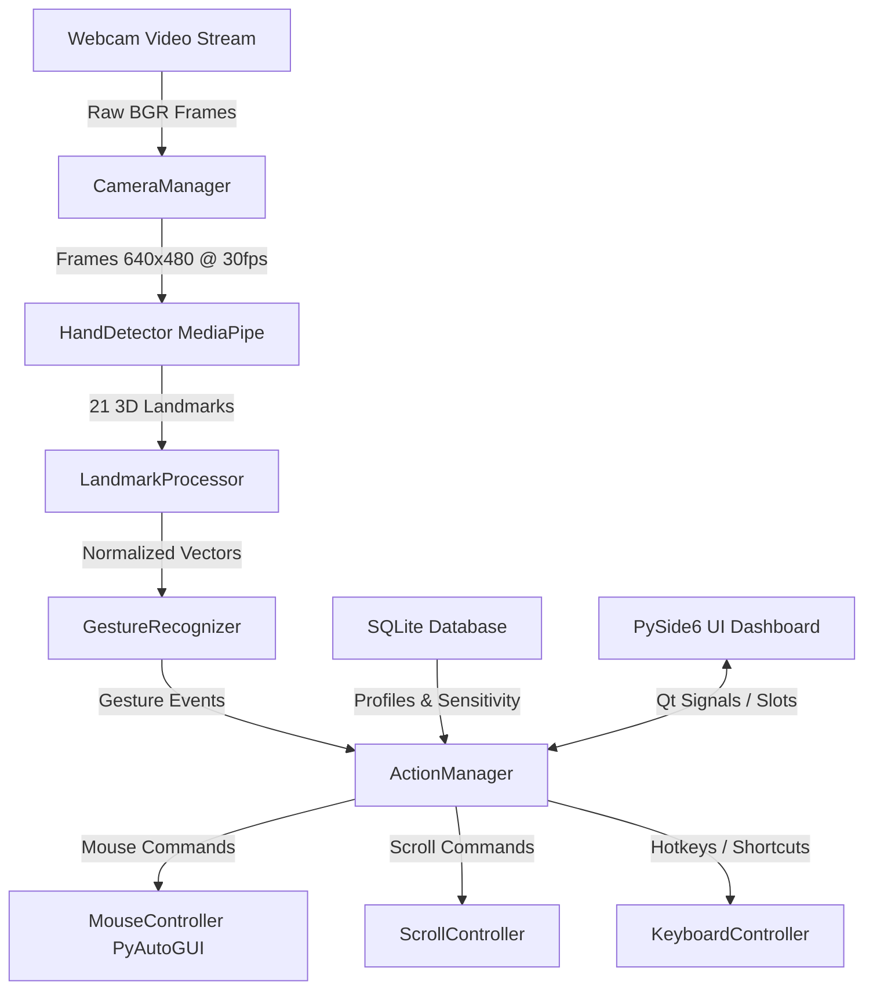

# VisionTouch AI: Touchless Laptop Control System

VisionTouch AI is an enterprise-grade, edge-computed desktop application that empowers users to control Windows laptops entirely through hand gestures captured by a webcam—no physical mouse, keyboard, or touch interaction required.

---

## 🏛️ System Architecture



---

## 🚀 Phase 1: Environment & Camera Subsystem Setup

### Requirements
- **OS**: Windows 10/11 (64-bit)
- **Runtime**: Python 3.10
- **Hardware**: Standard integrated or USB webcam (optimized for low-resource Intel Core i3 systems)

### Virtual Environment Setup
```powershell
# Create virtual environment
python -m venv .venv

# Activate virtual environment
.\.venv\Scripts\Activate.ps1

# Upgrade pip & install dependencies
python -m pip install --upgrade pip
pip install -r requirements.txt
```

### Running Camera Diagnostic
```powershell
python tests/run_camera_demo.py
```

### Running Unit Tests
```powershell
pytest tests/ -v
```

