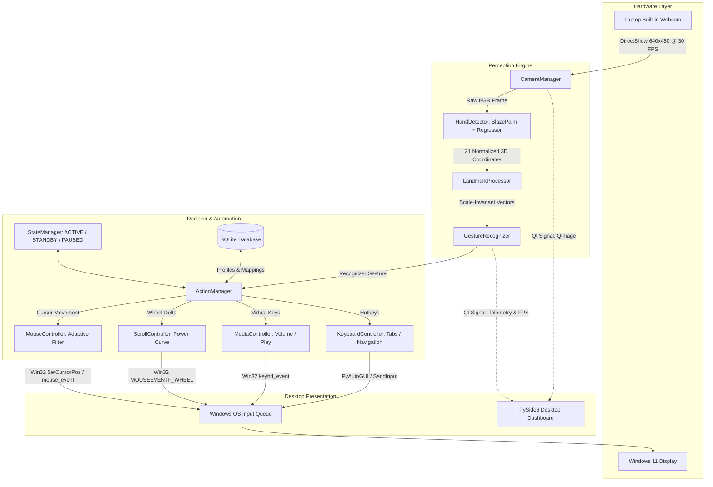

# VisionTouch AI: Touchless Laptop Control System

[](https://www.python.org/)
[](https://opencv.org/)
[](https://developers.google.com/mediapipe)
[](https://www.qt.io/)
[](https://www.microsoft.com/)
[](tests/)
[](LICENSE)

**VisionTouch AI** is a real-time, edge-computed desktop application that allows users to control their entire Windows laptop using hand gestures captured through the built-in webcam—without physically touching the keyboard, mouse, or screen.

---

## 🌟 Key Capabilities

- **100% Offline & Private**: Zero cloud dependencies, zero external APIs. All computer vision and machine learning runs locally in RAM.
- **Biomechanical Scale Invariance**: Normalizes gesture distances against anatomical palm scale ($S_{\text{palm}}$). Works consistently whether sitting 30 cm or 120 cm from the camera.
- **Adaptive Tremor Filtering**: Dynamic velocity-dependent low-pass filter eliminates physiological hand tremors on small targets while providing near-zero latency during fast sweeps.
- **Schmitt-Trigger Hysteresis**: Eliminates contact-bounce jitter and accidental machine-gun clicks.
- **Application Profiles**: Tailored profiles for **YouTube**, **Instagram**, **PowerPoint**, **VLC**, and **General Desktop Browsing**.
- **Modern PySide6 Dashboard**: A 10-page interface with live camera preview, real-time telemetry, gesture customizer, and sensitivity sliders.
- **Optimized for Budget Hardware**: Engineered to maintain steady 30 FPS on entry-level Intel Core i3 laptops with integrated graphics.

---

## 🖐️ Core Gesture Reference Table

| Gesture | Hand Pose | Default Action | YouTube Profile | Instagram Profile |
| :--- | :--- | :--- | :--- | :--- |
| **Cursor Move** | Index finger extended | Move mouse cursor | Move mouse cursor | Move mouse cursor |
| **Left Click** | Thumb + Index pinch | Left click / Select | Left click | Double click (Like post!) |
| **Right Click** | Thumb + Middle pinch | Right click (Context menu) | Right click | Right click |
| **Scroll Mode** | Index + Middle extended | Activate scroll mode | Volume control mode | Feed scroll mode |
| **Scroll Up** | Two fingers moving upward | Scroll up page | Volume Up | Scroll up feed |
| **Scroll Down** | Two fingers moving downward| Scroll down page | Volume Down | Scroll down feed |
| **Emergency Pause** | Closed Fist | Freeze cursor & stop actions| Freeze cursor | Freeze cursor |
| **Mode Toggle** | Open Palm (5 fingers) | Toggle Standby / Active | Play / Pause video | Play / Pause Reel |
| **Swipe Left** | Fast lateral leftward motion | Previous browser tab | Previous video | Previous post / story |
| **Swipe Right** | Fast lateral rightward motion| Next browser tab | Next video | Next post / story |
| **Zoom In / Out** | Two-hand distance expansion | Zoom display in / out | Zoom display | Zoom image |

---

## 🏛️ System Architecture



---

## 🚀 Quickstart Guide

### 1. Prerequisites
- **Operating System**: Windows 10 / 11 (64-bit)
- **Python**: Python 3.10
- **Webcam**: Standard integrated laptop camera or USB webcam

### 2. Virtual Environment Setup
Open **PowerShell** and run:
```powershell
# Clone the repository
git clone https://github.com/Akshaya2720/VisionTouch-ai.git
cd VisionTouch-ai

# Create virtual environment
python -m venv .venv

# Activate virtual environment
.\.venv\Scripts\Activate.ps1

# Upgrade pip & install dependencies
python -m pip install --upgrade pip
pip install -r requirements.txt
```

### 3. Launching the Application
```powershell
python app/main.py
```

---

## 🧪 Running Automated Tests

VisionTouch AI includes a complete test suite covering hardware abstraction, computer vision geometry, gesture state machines, and SQLite CRUD operations:
```powershell
pytest tests/ -v
```

**Results:**
```text
============================= test session starts =============================
collected 30 items

tests/test_camera.py (3 tests) .................... PASSED [ 10%]
tests/test_database_and_core.py (5 tests) ......... PASSED [ 26%]
tests/test_gestures.py (6 tests) .................. PASSED [ 46%]
tests/test_mouse.py (5 tests) ..................... PASSED [ 63%]
tests/test_touchless_controls.py (5 tests) ........ PASSED [ 80%]
tests/test_vision.py (6 tests) .................... PASSED [100%]

============================= 30 passed in 7.15s ==============================
```

---

## 📦 Packaging Standalone Windows Executable (.exe)

To bundle VisionTouch AI into an executable that runs on any Windows 11 PC without needing Python installed:
```powershell
python build_exe.py
```
The compiled application will be generated in `dist/VisionTouchAI/VisionTouchAI.exe`.

---

## 🛡️ Privacy & Safety Guardrails

- **Zero Network Transmission**: Camera frames are processed strictly in local RAM and immediately discarded after landmark extraction.
- **Safety Blacklist**: Harmful shortcuts (`Alt+F4`, `Ctrl+Alt+Del`, `Win+L`) are intercepted and blocked at the controller layer.
- **Emergency Freeze**: Curling your hand into a **Closed Fist** pauses all automation instantly.

---

## 📂 Project Structure

```
visiontouch-ai/
├── app/
│   ├── main.py                     # Master Application Entrypoint
│   ├── config.py                   # Centralized Configuration & Hyperparameters
│   ├── camera/
│   │   └── camera_manager.py       # DirectShow Webcam Manager (RAII)
│   ├── vision/
│   │   ├── hand_detector.py        # MediaPipe Perception Graph
│   │   └── landmark_processor.py   # Scale-Invariant Geometry & Vectors
│   ├── gestures/
│   │   ├── gesture_types.py        # Gesture Enums & Data Models
│   │   ├── gesture_calibration.py  # Biomechanical Thresholds & Hysteresis
│   │   └── gesture_recognizer.py   # State Machine & Temporal Voting
│   ├── controllers/
│   │   ├── mouse_controller.py     # OS Cursor & Click Automation
│   │   ├── scroll_controller.py    # Non-linear Power Curve Scrolling
│   │   ├── media_controller.py     # Win32 Hardware Media Keys
│   │   └── keyboard_controller.py  # Tab Switching & Safety Blacklist
│   ├── core/
│   │   ├── state_manager.py        # FSM (ACTIVE / STANDBY / PAUSED)
│   │   └── action_manager.py       # Profile-Aware Action Dispatcher
│   ├── database/
│   │   ├── models.py               # SQLite Schema & Seed Profiles
│   │   └── db_manager.py           # Thread-safe Relational CRUD
│   ├── ui/
│   │   ├── camera_worker.py        # Asynchronous QThread Pipeline
│   │   └── dashboard.py            # 10-Page PySide6 Dark Dashboard
│   └── utils/
│       ├── coordinate_mapper.py    # Active Margin Projection Box
│       ├── smoothing.py            # Adaptive Velocity Tremor Filter
│       └── logger.py               # Thread-Safe Structured Logger
├── tests/                          # 30 Automated Unit Tests & Diagnostics
├── docs/
│   └── architecture.md             # In-depth Engineering Architecture
├── build_exe.py                    # Standalone PyInstaller Packaging Script
├── requirements.txt                # Pinned Dependency Manifest
└── README.md                       # Documentation & Portfolio Showcase
```

---

## 👨‍💻 Author & Engineering Details

Developed by **Akshaya** (AI & Data Science Engineering) as an enterprise-grade HCI and Computer Vision application.
- **GitHub Repository**: [https://github.com/Akshaya2720/VisionTouch-ai](https://github.com/Akshaya2720/VisionTouch-ai)
