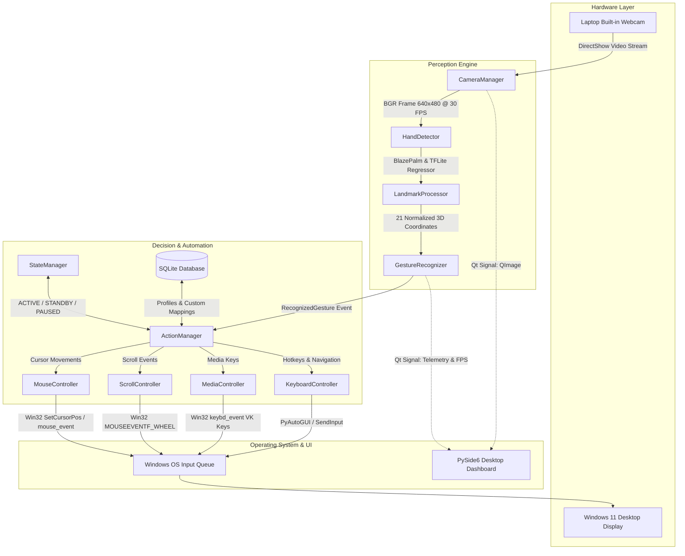

# VisionTouch AI: System Architecture & Technical Specification

## 1. Executive Summary
**VisionTouch AI** is a production-grade, edge-computed desktop system designed to deliver touchless human-computer interaction (HCI) on Windows 11. The application processes raw video streams from a standard built-in laptop webcam, extracts 21 three-dimensional skeletal landmarks per hand using deep regression networks, classifies complex biomechanical gestures, and translates them into native operating system input events.

---

## 2. High-Level Pipeline Architecture

---

## 3. Subsystem Breakdown

### 3.1 Camera Subsystem (`app/camera/`)
- **DirectShow Hardware Binding (`cv2.CAP_DSHOW`)**: Eliminates the 3–5 second Microsoft Media Foundation negotiation delay on Windows 10/11.
- **Resource Acquisition Is Initialization (RAII)**: Wrapped with Python `__enter__` and `__exit__` context protocols to guarantee OS device handles are freed even upon unexpected exceptions.
- **Framerate Stabilization**: Instantaneous framerates fluctuate due to OS scheduling. An Exponential Moving Average (EMA, $\alpha=0.2$) is applied to yield smooth, jitter-free FPS metrics.

### 3.2 Computer Vision Subsystem (`app/vision/`)
- **Two-Stage Detection & Tracking**:
  1. *Stage 1 (BlazePalm)*: Runs Single-Shot Detection across the full frame only on frame 0 or when hand tracking is lost.
  2. *Stage 2 (Hand Landmark Regressor)*: Predicts 21 3D coordinates on small, localized $256 \times 256$ crops, bypassing the heavy detector on $90\%+$ of frames.
- **Zero-Copy Memory Passing**: `rgb_frame.flags.writeable = False` passes buffers to the underlying C++ inference graph by reference without memory duplication.
- **Scale-Invariant Geometry**: All Euclidean distances are normalized by reference palm length $S_{\text{palm}} = \|\mathbf{p}_{\text{wrist}} - \mathbf{p}_{\text{middle\_mcp}}\|_2$, ensuring gesture thresholds function identically whether sitting $30\text{ cm}$ or $120\text{ cm}$ from the webcam.

### 3.3 Gesture Recognition Engine (`app/gestures/`)
- **Dual-Threshold Schmitt Trigger (Hysteresis)**: Prevents contact bounce / chatter. Entering a pinch requires distance $< 0.22$; releasing requires distance $> 0.32$.
- **Temporal Majority Voting**: A sliding circular ring buffer ($K=5$ frames) suppresses single-frame tracking artifacts and motion blur glitches.
- **Deadzone Filtering**: Filters human physiological tremors ($8\text{–}12\text{ Hz}$) smaller than $2.5\%$ screen height.

### 3.4 System Automation Controllers (`app/controllers/`)
- **Active Control Box Mapping**: Defines a 15% horizontal and 20% vertical margin inside the camera view, allowing comfortable hand movement across the central 70% of camera space to traverse 100% of the display.
- **Adaptive Tremor Filter (Dynamic $\alpha$)**:
  $$\alpha(v) = \alpha_{\min} + (\alpha_{\max} - \alpha_{\min}) \cdot \min\left(\frac{v}{V_{\text{threshold}}}, 1.0\right)$$
  Provides high smoothing ($\alpha \to 0.20$) on small button targets, and near-zero lag ($\alpha \to 0.85$) on ballistic sweeps.
- **Hardware Simulation**: Uses `ctypes.windll.user32.SetCursorPos` and `mouse_event` for sub-millisecond dispatch.

### 3.5 Database & State Management (`app/database/` & `app/core/`)
- **SQLite Schema**:
  - `user_settings`: Singleton configuration for sensitivity, margins, and active profile.
  - `profiles`: Application profiles (`Default`, `YouTube`, `Instagram`, `PowerPoint`, `VLC`).
  - `gesture_mappings`: Relational mappings with `ON DELETE CASCADE`.
- **State Machine**:
  - `ACTIVE`: Normal automation running.
  - `STANDBY`: Camera running, actions paused (toggled via Open Palm).
  - `PAUSED`: Emergency freeze (triggered via Closed Fist).

### 3.6 Desktop Presentation Layer (`app/ui/`)
- **PySide6 / Qt 6**: Modern minimal dark theme (`#121212`, `#1E1E1E`, `#0078D4`).
- **Decoupled Concurrency**: `CameraWorker(QThread)` runs video capture and inference off the UI thread, ensuring a locked 60 FPS interface with zero stutter.

---

## 4. Hardware Optimization for Low-End Systems (Intel Core i3)

To ensure smooth operation on resource-constrained hardware:
1. **Resolution Budget**: Capped at $640 \times 480$ (VGA) @ 30 FPS. Processing 1080p yields no precision gain in MediaPipe and increases memory bus traffic by $675\%$.
2. **Model Complexity**: Pinned to `model_complexity=0` (Lite), utilizing quantized MobileNetV2-based backbones with XNNPACK CPU acceleration.
3. **Throttled Event Dispatch**: Scroll events are capped at $25\text{ Hz}$ to avoid saturating Windows message queues.

